# System sztucznej inteligencji - Projekt Zaliczeniowy

## Źródło danych

W projekcie zostały wykorzystane dane dotyczące ekonomii gry Path of Exile. 
Strona [poe.ninja](https://poe.ninja) zajmuje się agregacją tych danych w czasie rzeczywistym. 
Wybrane zostały dane dotyczące wymiany walut z 2 ostatnich lat - 5 cykli gry nazywanych ligami - ang. leagues.

Dane zostały pobrane z zakładki Data dumps na stronie [poe.ninja/poe1/data](https://poe.ninja/poe1/data).     
Dane podlegają licencji cc-by-sa.

Przykład danych z pliku Keepers.currency.csv:

```csv
League;Date;Get;Pay;Value;Confidence
Keepers;2025-10-31;Chromatic Orb;Chaos Orb;0.2;High
Keepers;2025-11-01;Chromatic Orb;Chaos Orb;0.19231;High
Keepers;2025-11-02;Chromatic Orb;Chaos Orb;0.19231;High
Keepers;2025-11-03;Chromatic Orb;Chaos Orb;0.16667;High
Keepers;2025-11-04;Chromatic Orb;Chaos Orb;0.1497;High
```

## Przygotowanie danych

Dane uległy transformacji - uzależniono wszystkie waluty od "Chaos Orb" - głównej waluty do wymiany w grze. Zawiera ona najwięcej danych o najlepszym współczynniku Confidence. 
Data zamieniana jest na liczbę dnia ligii. Każda liga jest zapisywana w osobnym DataFrame. 

Przekonwertowane dane mają charakter szeregów czasowych. Dane do treningu zostaną poukładane w odpowiednie serie dni. Celem modeli będzie przewidzenie wartości na podstawie poprzednich dni, np. wartość waluty dnia 15, mają informacje o poprzednich 14 dniach. 

```python
def read_currency_data(filepath: str, start_date: str):
    """
    reads file and cuts the unnecessary data: League and Confidence.
    Date is changed into day of the league, to transform date into number.
    returns DataFrame
    """
    df = pd.read_csv(filepath, sep=';', skipinitialspace=True)
    df['Date'] = pd.to_datetime(df['Date'])
    df = df[df['Pay'] == 'Chaos Orb']
    df['Day of league'] = (df['Date'] - pd.to_datetime(start_date)).dt.days + 1
    columns_to_drop = ['League', 'Date', 'Pay', 'Confidence']
    df = df.drop(columns=columns_to_drop)
    df = df.reset_index(drop=True)
    return df
```

Dane przycinane są do 100 dni, aby wyrównać zakresy. Jedna liga okazała się zbyt długa w porównaniu do reszty lig. 

```python
def transform_currency_data(df):
    """
    Drop with all NaN
    Drop with 5 NaN's in Row - bad data
    Fill NaN's with data from day before, and fill first day's
    Cuts data to 100 days (Settlers is too large)
    returns DataFrame
    """
    df = df.pivot(index='Day of league', columns='Get', values='Value')
    df = df.dropna(axis=1, how='all')
    df = df.dropna(axis=1, thresh=len(df) - 4)
    df = df.ffill().bfill()
    df = df[df.index <= 100]
    return df.T
```

Wybrana została waluta "Divine Orb", natomiast okno czasowe to 14 dni.
```python
ITEM = "Divine Orb"
WINDOW = 14
```

Próbka danych wykorzystywanych do trenowania, są to listy o długości okna. 
```
Dane treningowe: (344, 14)
[[1.         2.31578947 2.84210526 ... 4.57355263 4.39473684 4.07894737]
 [2.31578947 2.84210526 3.60526316 ... 4.39473684 4.07894737 4.02631579]
 [2.84210526 3.60526316 3.76315789 ... 4.07894737 4.02631579 3.94736842]
 ...
 [2.69439421 2.67631103 2.62206148 ... 2.53164557 2.53164557 2.53164557]
 [2.67631103 2.62206148 2.60759494 ... 2.53164557 2.53164557 2.48101266]
 [2.62206148 2.60759494 2.60262206 ... 2.53164557 2.48101266 2.44122966]]
```

Nie zastosowano standardowego podziału na zbiór testowy i zbiór treningowy. Dane mają charakter sygnałowy i szeregów czasowych, dlatego jeden ze zbiorów danych zostanie zbiorem treningowym. Tutaj, wybrano najnowszy zbiór `Keepers`. 

```python
TEST_LIGA = -1
leagues = [necropolis_df, affiliction_df, settlers_df, mercenaries_df, keepers_df]
test_idx = TEST_LIGA % len(leagues)
```

## Wykrywanie anomalii

Wykorzystano 4 modele do detekcji anomalii: IsolationForest, OneClassSVM, LocalOutlierFactor oraz EllipticEnvelope. 
Założono 0.1 zanieszczenia danych. 

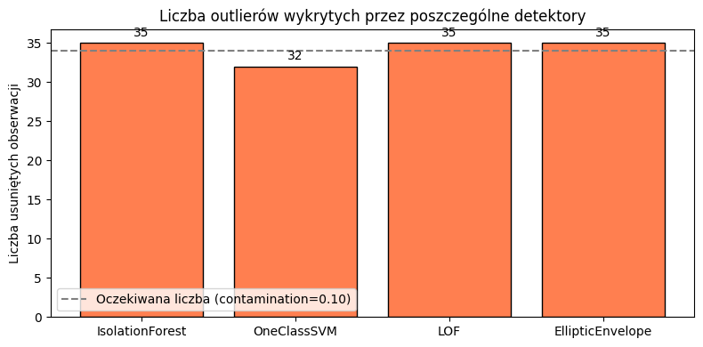

Najbardziej czułym modelem na usunięcie anomalii była sieć neuronowa. Reszta modeli nie zmieniała znacząco wyników, przy wyczyszczeniu danych. 


Parametry modeli wykrywania anomalii:
```python
detectors = {
    'IsolationForest': IsolationForest(contamination=contamination, random_state=42),
    'OneClassSVM': OneClassSVM(nu=contamination, kernel='rbf', gamma='scale'),
    'LOF': LocalOutlierFactor(n_neighbors=20, contamination=contamination, novelty=False),
    'EllipticEnvelope': EllipticEnvelope(contamination=contamination, random_state=42)
}
```

### Isolation Forest

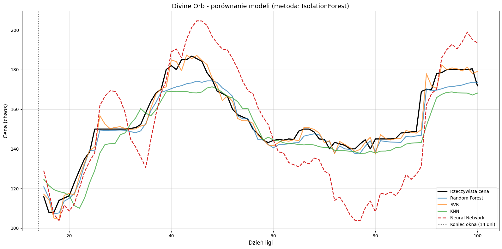

Model KNN osiągnał najlepszy R2, po zastosowaniu detekcji anomalii za pomocą Isolation Forest. Natomiast, IF najbardziej zaszkodził sieci neuronowej, powodując najgorszy wynik. 

### One Class SVM

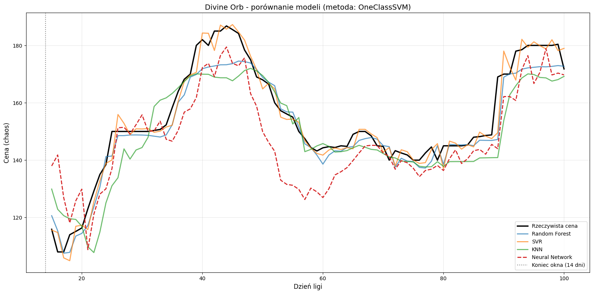

One Class SVM nie wpłynął znacząco na poprawę jakości modeli, osiągnał nieznacznie lepsze lub nieznacznie gorsze wyniki w porównaniu z oryginalnymi danymi dla klasycznych modeli, natomiast, dla sieci neuronowej osiągnął wynik podobny do LOF i EllipticEnvelope. 
 
### LocalOutlierFactor

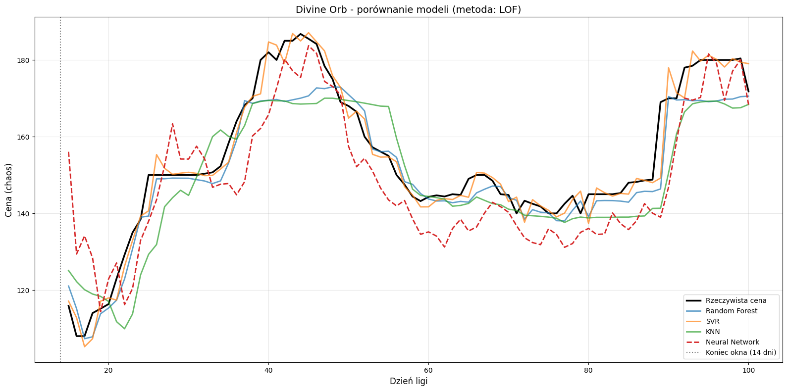

Model LOF okazał się najlepszy dla Support Vector Regressor. Dzięki temu model osiągnał najlepsze metryki ze wszystkich. Reszta wyników dla LOF nie odbiegała znacząco od reszty modeli. 

### Elliptic Envelope

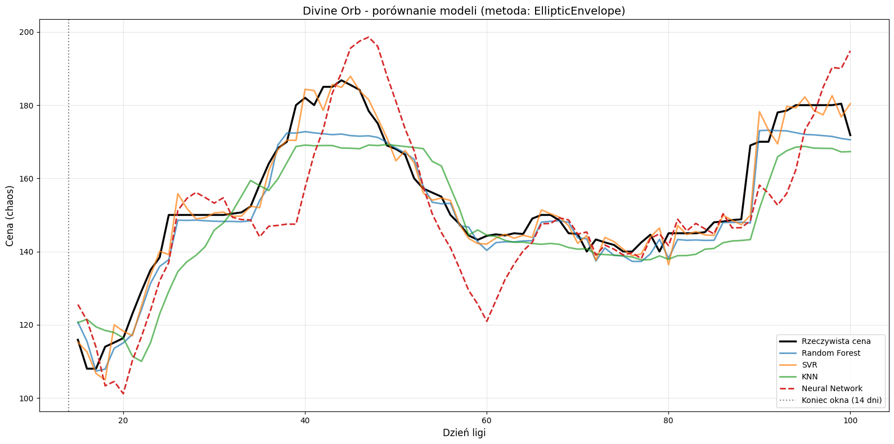

EllipticEnvelope nie pomógł, ale też nie zaszkodził. Wykorzystanie tego modelu nie wskazuje na znaczącą poprawę danych. 

### Oryginalne dane

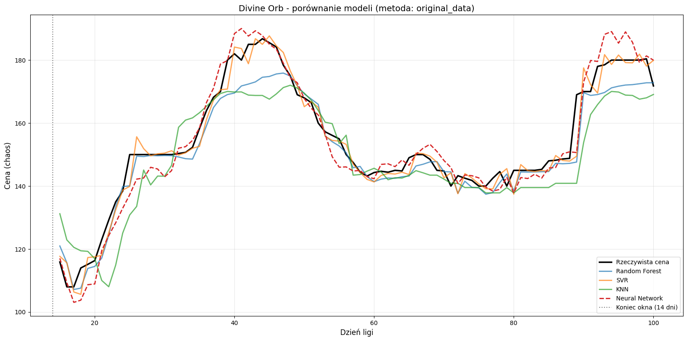

Sieć neuronowa osiągneła najlepsze wyniki, kiedy wykorzystano dane "bez czyszczenia". Reszta modeli osiągneła podobne metryki, niezależnie od detekcji anomalii. 

## Uczenie modeli 

Do znalezienia najlepszych parametrów, wykorzystano `GridSearchCV`, ze strategią `TimeSeriesCrossValidation`, ponieważ dane mają charakter szeregów czasowych. Zachowuje to chronologię obserwacji i pozwala uniknąć przeciekowi informacji. Kryterium wyboru jest średni błąd `neg_mean_absolute_error`. 
Wyszukiwanie parametrów zostało przeprowadzone dla danych orignalnych oraz danych po anomalii. 

Każdy model został oceniony poniższymi metrykami:
- MEA: Mean Absolute Error - Średni błąd bezwzględny 
  - im niższa wartość tym model jest bardziej dokładny
- MAPE: Mean Absolute Percentage Error - Średni bewzględny błąd procentowy
  - o jaki %, model przeciętnie się myli
- MSE: Mean Squared Error - Średni błąd kwadratowy
  - większe błędy są karane bardziej niż małe błędy
- R2: Coefficient of Determination - Współczynnik determinacji
  - miara dopasowania modelu do danych
  - 1 to idealne dopasowanie
  - 0 oznacza brak poprawy względem dopasowania średnią

## RandomForest

Wykorzystano `RandomForestRegressor` do stworzenia modelu regresji, na podstawie drzew decyzyjnych.

### Parametry kalibracji 

Model trenowano na wszystkich rdzeniach procesora (`n_jobs = -1`). 
Wykorzystane parametry:
- `n_estimators`: liczba drzew, wchodząca w skład lasu losowego
- `max_depth`: maksymalna głębokość pojedynczego drzewa
- `min_samples_split`: minimalna liczba próbek do podziału węzła
- `min_samples_leaf`: minimalna liczba próbek w liściu drzewa

```python
rf_param_grid = {
    'n_estimators': [100, 200],
    'max_depth': [10, 20, None],
    'min_samples_split': [5, 10],
    'min_samples_leaf': [2, 4]
}

rf_base = RandomForestRegressor(random_state=42, n_jobs=-1)
rf_grid = GridSearchCV(
    estimator=rf_base,
    param_grid=rf_param_grid,
    cv=tscv,
    scoring='neg_mean_absolute_error',
    n_jobs=-1,
    verbose=1
)
```

### Ocena

Wynik uczenia Random Forest dla danych oryginalnych: 

```
============================================================
Przetwarzanie danych: original_data
============================================================
Fitting 5 folds for each of 24 candidates, totalling 120 fits
  MAE:  4.01
  MAPE: 2.52%
  MSE:  31.31
  R²:   0.9131
  best_params: {
    'max_depth': 20, 
    'min_samples_leaf': 2, 
    'min_samples_split': 5, 
    'n_estimators': 100
  }
```

Uzyskany model osiągnął dobre wyniki predykcyjne. Współczynnik R2 na poziomie 0.9131 wskazuje na to, że model wyjaśnia 91% zmienności danych. Niska wartość błędu Mean Absolute Pecentage Error świadczy o dobrej jakości prognozy. 

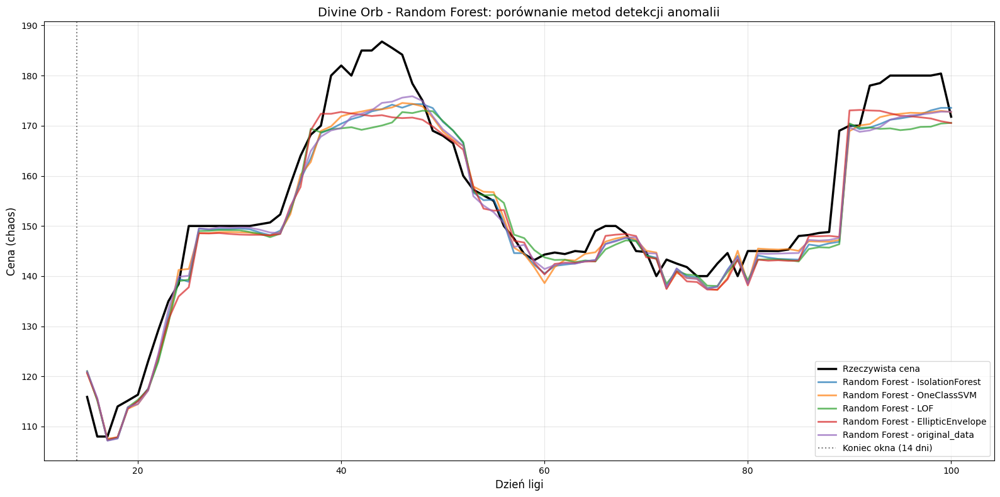

## Support Vector Regressor

### Parametry kalibracji 

W celu optymalizacji modelu zastosowano metodę przeszukiwania siatki parametrów `GridSearchCV`. Przetestowano następujące hiperparametry:
- `kernel`: typ funkcji wykorzystywanej przez jądro
  - `rbf` - radial basis function, nie liniowy
  - `linear` - liniowa 
- `C`: parametr kontrolujący kompromis pomiędzy dokładnością, a generalizacją modelu 
- `epsilon`: szerokość marginesu błędu, w którym oddalenia nie są karane
- `gamma`: parametr wpływający na zasięg oddziaływania pojedynczych punktów. 
  - Dla `linear` gamma jest ignorowany.

```python
svr_param_grid = {
    'kernel': ['rbf', 'linear'],
    'C': [1, 10, 100],
    'epsilon': [0.05, 0.1],
    'gamma': ['scale', 0.1, 1]
}

svr_base = SVR()
svr_grid = GridSearchCV(
    estimator=svr_base,
    param_grid=svr_param_grid,
    cv=tscv,
    scoring='neg_mean_absolute_error',
    n_jobs=-1,
    verbose=1
)
```

### Ocena

Dla oryginalnych danych, model SVR osiągnał takie wyniki:

```
============================================================
Przetwarzanie danych: original_data
============================================================
Fitting 5 folds for each of 36 candidates, totalling 180 fits
  MAE:  2.72
  MAPE: 1.79%
  MSE:  16.60
  R²:   0.9540
  best params: {
    'C': 10, 
    'epsilon': 0.05, 
    'gamma': 'scale', 
    'kernel': 'linear'
  }
```

Model SVR osiągnął najlepsze wyniki spośród wszystkich analizowanych modeli. Współczynnik R2 wyjaśnia 95% zmienności danych. Mean Square Error (MSE) jest prawie dwukrotnie mniejszy niż w przypadku Random Forest.  

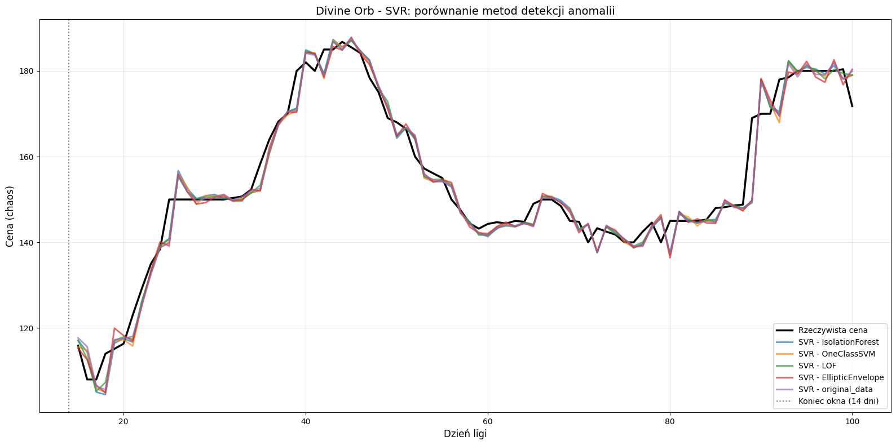

## K Nearest Regressor

### Parametry kalibracji 

Do strojenia modelu `KNeighborsRegressor` wykorzystano metodę `GridSearchCV` z walidacją krzyżową dla szeregów czasowych (`TimeSeriesSplit`).

Przeanalizowany następujące parametry:
- `n_neighbors`: liczba najbliższych sąsiadów, wykorzystywanych podczas predykcji
- `weights`: sposób wyboru wagi dla sąsiadów:
  - `uniform`: wszyscy sąsiedzi mają taki sam wpływ
  - `distance`: im bliżej, tym większy wpływ na wynik
- `p`:" metryka Minkowskiego:
  - `p=1`: oznacza odległość Manhattan
  - `p=2`: oznacza odległość euklidesową
- `algorithm`: algorytm wyszukiwania najbliższych sąsiadów
  - `auto`: algorytm sam decyduje o najlepszym algorytmie dla danych
  - `ball_tree`: tworzy hypersferę
  - `kd_tree`: tworzy drzewo binarne

```python
knn_param_grid = {
    'n_neighbors': [3, 5, 7, 9, 11, 15],
    'weights': ['uniform', 'distance'],
    'p': [1, 2],
    'algorithm': ['auto', 'ball_tree', 'kd_tree']
}

knn_base = KNeighborsRegressor()
knn_grid = GridSearchCV(
    estimator=knn_base,
    param_grid=knn_param_grid,
    cv=tscv,
    scoring='neg_mean_absolute_error',
    n_jobs=-1,
    verbose=1
)
```

### Ocena

Dla pełnego zbioru danych, algorytm KNR osiągnał następujące wyniki:

```
============================================================
Przetwarzanie danych: original_data
============================================================
Fitting 5 folds for each of 72 candidates, totalling 360 fits
  MAE:  7.44
  MAPE: 4.85%
  MSE:  89.41
  R²:   0.7519
  best params: {
    'algorithm': 'auto', 
    'n_neighbors': 7, 
    'p': 2, 
    'weights': 'uniform'
  }
```

Model kNN osiągnął wyraźnie słabsze wyniki niż modele SVR oraz Random Forest. Wartość współczynnika determinacji R2 = 0.7519 oznacza, że model wyjaśnia około 75% zmienności danych. 

Na wykresie warto zauważyć pewne przesunięcie, w porównaniu z danymi rzeczywistymi. Dodatkowo, w okolicy dni 40-50, cena znacząco zwiększyła się. Algorytm KNR nie potrafił przewidzieć takiego skoku w danych. 

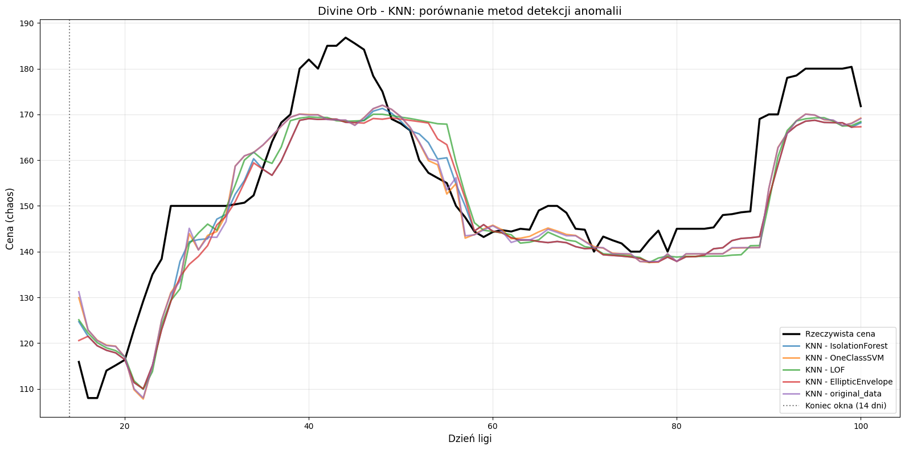

## Sieć Neuronowa

### Parametry kalibracji 

W eksperymencie wykorzystano model głębokiej sieci neuronowej do realizacji regresji. Przetestowano kilka konfiguracji architektury sieci, które różnią się:
- liczbą wartsw ukrytych
- liczbą neuronów w warstwie
- funkcjami aktywacji (`activations`)
  - `relu`: Rectified Linear Unit. `f(x) = max(0,x)`
  - `elu`: Exponential Linear Unit. `f(x) = { x, x > 0; a*(e^x - 1), x < 0 }`
  - `leaky_relu`: Modyfikacja ReLU. `f(x) = { x, x > 0; a*x, x < 0 }`
- poziomem regularyzacji (`dropout`)
  - współczynnik losowo wyłącza neurony, aby ogranicznyć przeuczenie
- współczynnkiem uczenia (`lr`)
  - współczynnik uczenia, kontrolujący szybkość aktualizacji wag

```python
nn_configs = [
    {
        'layers': [64, 32, 16], 
        'dropout': 0.3,
        'lr': 0.001, 
        'activations': 'relu'
    },
    {
        'layers': [128, 64, 32, 16], 
        'dropout': 0.2, 
        'lr': 0.001,
        'activations': ['elu', 'elu', 'elu', 'relu']
    },
    {
        'layers': [8, 16, 32, 64, 32, 16, 8], 
        'dropout': 0.2,
        'lr': 0.0005, 
        'activations': 'relu'
    },
    {
        'layers': [32, 32, 32, 32, 32], 
        'dropout': 0.4,
        'lr': 0.001, 
        'activations': 'leaky_relu'
    },
]
```

### Ocena

Dla oryginalnych danych, sieć neuronowa poradziła sobie w miarę dobrze. 

```
============================================================
Przetwarzanie danych: original_data
============================================================
Testowanie: {
    'layers': [64, 32, 16], 
    'dropout': 0.3, 
    'lr': 0.001, 
    'activations': 'relu'
  }
  Val MAE: 0.1007
Testowanie: {
    'layers': [128, 64, 32, 16], 
    'dropout': 0.2, 
    'lr': 0.001, 
    'activations': ['elu', 'elu', 'elu', 'relu']
  }
  Val MAE: 0.0903
Testowanie: {
    'layers': [8, 16, 32, 64, 32, 16, 8], 
    'dropout': 0.2, 
    'lr': 0.0005, 
    'activations': 'relu'
  }
  Val MAE: 1.0480
Testowanie: {
    'layers': [32, 32, 32, 32, 32], 
    'dropout': 0.4, 
    'lr': 0.001, 
    'activations': 'leaky_relu'
  }
  Val MAE: 0.1651
  
  MAE:  3.98
  MAPE: 2.63%
  MSE:  26.92
  R²:   0.9253
  best params: {
    'layers': [128, 64, 32, 16], 
    'dropout': 0.2, 
    'lr': 0.001, 
    'activations': ['elu', 'elu', 'elu', 'relu']
  }
```

Model sieci neuronowej osiągnął dobre wyniki predykcyjne i uzyskał lepsze rezultaty niż model kNN oraz nieco lepsze niż Random Forest. 

Najskuteczniejsza architektura wykorzystywała malejącą liczbę neuronów w kolejnych warstwach oraz funkcje aktywacji ELU. Może to sugerować, że bardziej elastyczne funkcje aktywacji lepiej radziły sobie z modelowaniem nieliniowych zależności w danych.

Jednocześnie model SVR osiągnął lepsze wyniki końcowe niż sieć neuronowa, szczególnie pod względem wartości MAE i MSE. Może to wskazywać, że dla analizowanego zbioru danych bardziej złożona architektura głębokiego uczenia nie dawała istotnej przewagi nad klasycznymi metodami regresji.

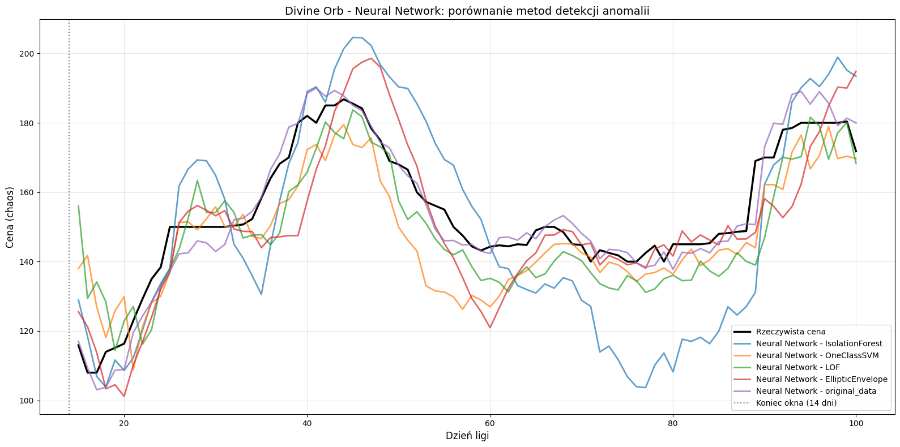

## Rozmyty System Ekspercki

### Zasady 

W celu wspomagania procesu podejmowania decyzji inwestycyjnych, opracowano rozmyty system ekspercki opraty na logice rozmytej (fuzzy logic). System analizuje aktualną cenę, przewidywaną zmianę ceny i generuje decyzje:
- KUP
- TRZYMAJ
- SPRZEDAJ

System analizuje dwa wejścia:
- `cena` - aktualna cena przedmiotu
- `delta` -  różnica pomiędzy prognozowaną ceną, a aktualną ceną

Wyjściem systemu jest:
- `decyzja` - wartość określająca rekomendację

```python
cena = ctrl.Antecedent(np.arange(0, 301, 1), 'cena')
delta = ctrl.Antecedent(np.arange(-50, 51, 1), 'delta')
decyzja = ctrl.Consequent(np.arange(-1, 1.01, 0.01), 'decyzja')
```

Zdefiniowano trzy zbiory rozmyte dla `cena`, aby zamodelować zbiory, wykorzystano trójkątne funkcje przynależności:
- `niska`: 0 - 120
- `średnia`: 100 - 200
- `wysoka`: 170 - 300

```python
cena['niska'] = fuzz.trimf(cena.universe, [0, 0, 120])
cena['srednia'] = fuzz.trimf(cena.universe, [100, 150, 200])
cena['wysoka'] = fuzz.trimf(cena.universe, [170, 250, 300])
```

Analogicznie, dla zmiennnej `delta`, przygotowano trzy różne stany:
- `spadnie`: -50 - 0
- `stabilna`: -5 - 5
- `wzrosnie` - 0 - 50

```python
delta['spadnie'] = fuzz.trimf(delta.universe, [-50, -15, 0])
delta['stabilna'] = fuzz.trimf(delta.universe, [-5, 0, 5])
delta['wzrosnie'] = fuzz.trimf(delta.universe, [0, 15, 50])
```

Zmienna wyjściowa otrzymała również trzy klasy:
- `sprzedaj` - wartości ujemne to sprzedaż
- `trzymaj` - wartości bliskie 0 to utrzymanie pozycji
- `kup` - wartości dodatnie to zakup

```python
decyzja['sprzedaj'] = fuzz.trimf(decyzja.universe, [-1, -1, -0.2])
decyzja['trzymaj'] = fuzz.trimf(decyzja.universe, [-0.3, 0, 0.3])
decyzja['kup'] = fuzz.trimf(decyzja.universe, [0.2, 1, 1])
```

Stworzono zestaw reguł `IF-THEN`, na podstawie których system podejmuje decyzje. 
```python
rules = [
    ctrl.Rule(cena['niska'] & delta['wzrosnie'], decyzja['kup']),
    ctrl.Rule(cena['wysoka'] & delta['spadnie'], decyzja['sprzedaj']),
    ctrl.Rule(cena['srednia'] & delta['wzrosnie'], decyzja['kup']),
    ctrl.Rule(cena['srednia'] & delta['spadnie'], decyzja['sprzedaj']),
    ctrl.Rule(cena['niska'] & delta['spadnie'], decyzja['trzymaj']),
    ctrl.Rule(cena['wysoka'] & ~delta['spadnie'], decyzja['trzymaj']),
    ctrl.Rule(cena['niska'] & delta['stabilna'], decyzja['kup']),
    ctrl.Rule(cena['srednia'] & delta['stabilna'], decyzja['trzymaj']),
    ctrl.Rule(cena['wysoka'] & delta['stabilna'], decyzja['sprzedaj']),
]
```

Taką regułe można zapisać jako: 

```python
# JEŻELI cena jest niska ORAZ prognoza wskazuje wzrost TO decyzja = kup

ctrl.Rule(cena['niska'] & delta['wzrosnie'], decyzja['kup']),
```

### Działanie

Prognoza cen pochodziła z uśrednienia wyników modeli regresyjnych, użytych w tym eksperymencie:
- Random Forest
- KNN
- SVR
- Neural Network

Dla każdego dnia pobrano aktualną cenę przedmiotu, obliczono prognozowaną zmianę ceny. Na podstawie tych danych, system ekspercki wyznaczył wartość decyzji. Ten wynik klasyfikowano jako:
- KUP (`> 0.15`)
- TRZYMAJ (`< -0.15`)
- SPRZEDAJ

```python
expert = build_fuzzy_expert()

decisions_log = []
for t in range(start_day, end_day):
    current_price = prices[t]
    day_num = t - start_day + 1

    prognoza_value = daily_avg_all.get(day_num)
    if prognoza_value is None:
        prognoza_value = prices[t - WINDOW:t].mean()

    expert.input['cena'] = current_price
    expert.input['delta'] = prognoza_value - current_price

    try:
        expert.compute()
        decision_value = expert.output['decyzja']
    except (KeyError, ValueError):
        decision_value = 0.0

    if decision_value > 0.15:
        decision_text = "KUP"
    elif decision_value < -0.15:
        decision_text = "SPRZEDAJ"
    else:
        decision_text = "TRZYMAJ"

    decisions_log.append(
        (t + 1, current_price, prognoza_value, decision_value, decision_text))
```

Symulacja została przeprowadzona dla 86 dni, na danych testowych.

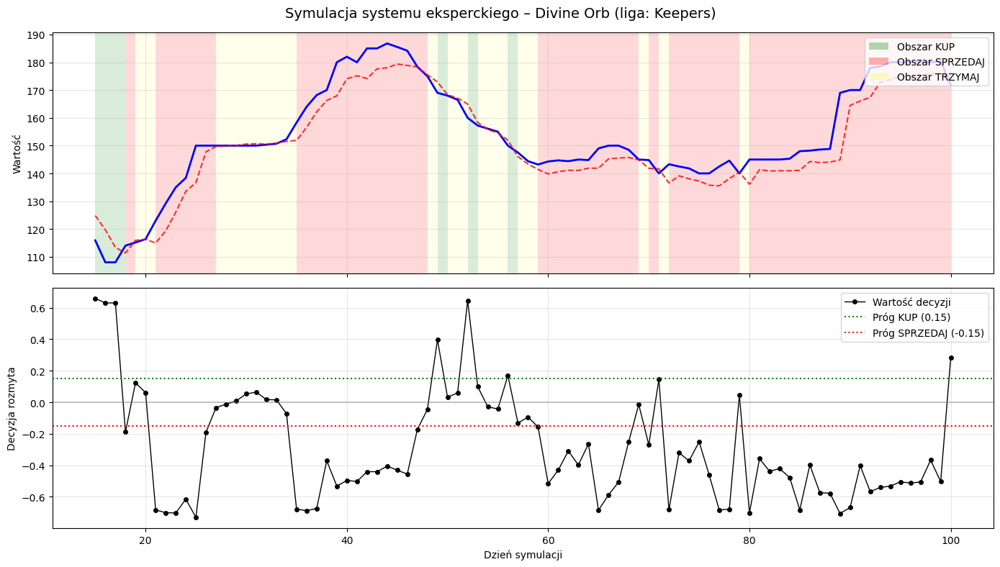

### Podsumowanie wyników:

```
--- PODSUMOWANIE ---
  KUP: 7 razy (8.1%)
  SPRZEDAJ: 58 razy (67.4%)
  TRZYMAJ: 21 razy (24.4%)
```

Zastosowanie logiki rozmytej umożliwiło modelowanie niepewności oraz bardziej elastyczne podejmowanie decyzji niż w przypadku klasycznych reguł binarnych. System nie wymagał sztywnych progów cenowych i potrafił uwzględniać częściową przynależność do wielu zbiorów jednocześnie.

Jednocześnie skuteczność systemu była silnie uzależniona od jakości prognoz modeli regresyjnych oraz poprawności zaprojektowanych reguł eksperckich. W praktyce oznacza to, że błędne prognozy mogły prowadzić do nieoptymalnych decyzji inwestycyjnych.

## Wnioski

Celem projektu było opracowanie oraz porównanie modeli predykcji cen, wykorzystując techniki uczenia maszynowego. W eksperymencie przeanalizowano szeregi czasowe, dla których zastosowano klasyczne modele regresyjne, jak i sieci neuronowe. 

Modele oceniano przy pomocy metryk:
- MAE,
- MAPE,
- MSE,
- R2

Najlepsze wyniki osiągnął model Support Vector Regressor, który uzyskał:
- MAE = 2.72,
- MAPE = 1.79%,
- MSE = 16.60,
- R2 = 0.9540.

Model Random Forest również osiągnał dobre rezultaty, R2 = 0.91, ale był mniej dokładny niż SVR. Dla oryginalnych danych, wyniki podobne do RF uzyskała sieć neuronowa, ale tylko dla oryginalnych danych. Eliminowanie anomalii z danych znacznie pogorszyło jakość działania sieci neuronowej. 

Model kNN osiągnał najgorsze wyniki dla danych oryginalnych. Można wnioskować, że kNN jest mniej odporny na charakterystykę szeregów czasowych. 

```
Eksperyment            Model     MAE    MAPE      MSE     R²
 Random Forest  IsolationForest  4.2183  2.6492  33.4782 0.9071
 Random Forest      OneClassSVM  4.0525  2.5586  30.8388 0.9144
 Random Forest              LOF  4.6732  2.9058  42.5053 0.8821
 Random Forest EllipticEnvelope  4.3143  2.7161  33.9479 0.9058
 Random Forest    original_data  4.0066  2.5183  31.3055 0.9131
           SVR  IsolationForest  2.6765  1.7679  16.1445 0.9552
           SVR      OneClassSVM  2.7969  1.8387  17.4588 0.9516
           SVR              LOF  2.5577  1.6769  15.2505 0.9577
           SVR EllipticEnvelope  2.8302  1.8597  17.5082 0.9514
           SVR    original_data  2.7183  1.7883  16.5969 0.9540
           KNN  IsolationForest  7.5045  4.8288  87.8985 0.7561
           KNN      OneClassSVM  7.3505  4.7869  88.3379 0.7549
           KNN              LOF  7.9715  5.1512  96.8545 0.7313
           KNN EllipticEnvelope  7.8936  5.0669  94.2837 0.7384
           KNN    original_data  7.4375  4.8459  89.4110 0.7519
Sieć neuronowa  IsolationForest 16.4209 10.8050 355.4596 0.0137
Sieć neuronowa      OneClassSVM  9.4845  6.3217 138.2944 0.6163
Sieć neuronowa              LOF  9.1974  6.2302 127.5432 0.6461
Sieć neuronowa EllipticEnvelope  9.1799  5.8987 139.4820 0.6130
Sieć neuronowa    original_data  3.9811  2.6279  26.9234 0.9253

================================================================================
NAJLEPSZE WYNIKI
================================================================================

Najlepszy wynik dla MAE:
  Eksperyment: SVR
  Model detekcji anomalii: LOF
  Wartość MAE: 2.5577

Najlepszy wynik dla MAPE:
  Eksperyment: SVR
  Model detekcji anomalii: LOF
  Wartość MAPE: 1.6769

Najlepszy wynik dla MSE:
  Eksperyment: SVR
  Model detekcji anomalii: LOF
  Wartość MSE: 15.2505

Najlepszy wynik dla R²:
  Eksperyment: SVR
  Model detekcji anomalii: LOF
  Wartość R²: 0.9577
```

## Autor
Kacper Wiącek, 99733, Informatyka II stopnia, grupa 4.8